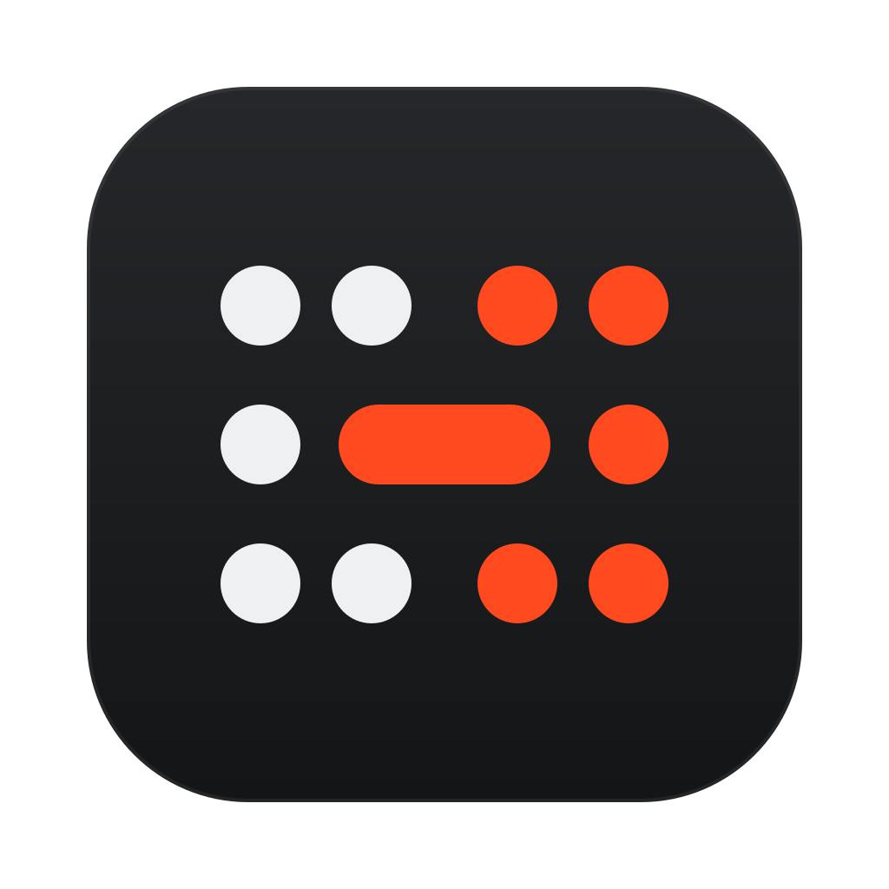
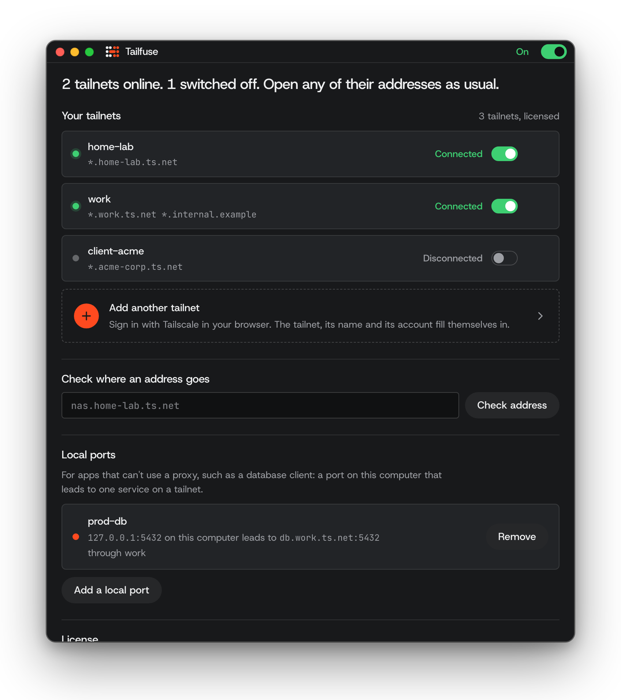
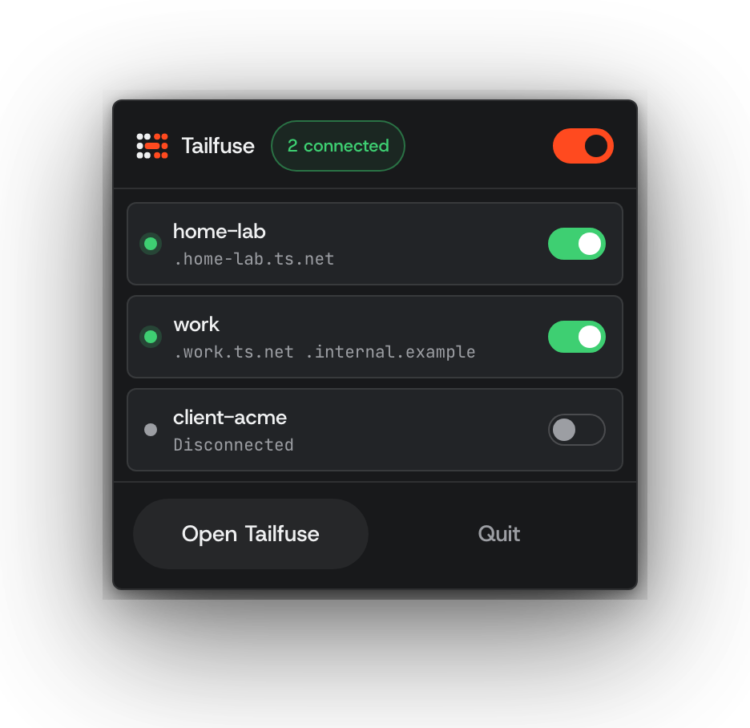
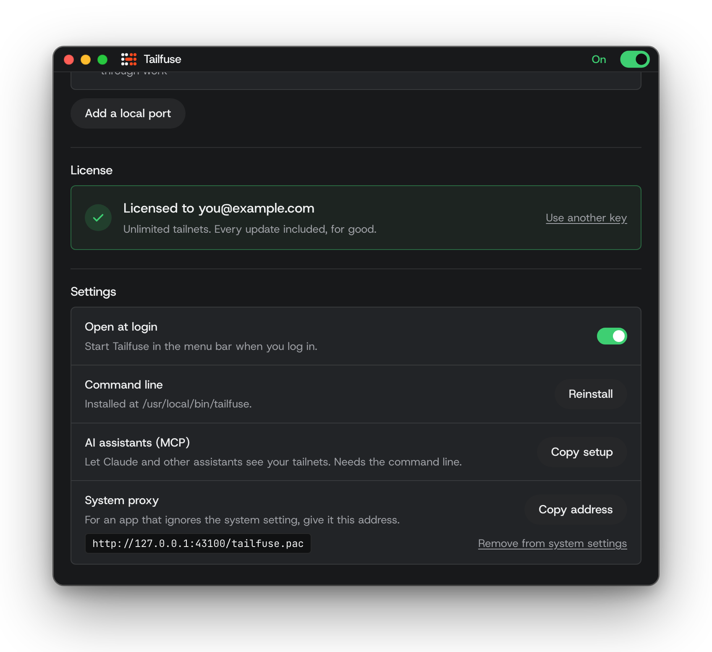

<p align="center"></p>

<h1 align="center">Tailfuse</h1>

<p align="center"><strong>Several Tailscale tailnets, online at once.</strong><br>
No VM, no daemon conflicts, no account switching. macOS, Windows and Linux.</p>

<p align="center">
  <a href="https://tailfuse.com/download"><strong>Download</strong></a> ·
  <a href="https://tailfuse.com">tailfuse.com</a> ·
  <a href="#use-with-ai-assistants-mcp">MCP server</a> ·
  <a href="https://github.com/ailio-technologies-inc/tailfuse/releases">Releases</a>
</p>

<p align="center"></p>

One embedded Tailscale node (userspace-mode `tailscaled`) per tailnet, a loopback router that dispatches traffic by hostname suffix, and a menu-bar app to drive it all.

<table>
<tr>
<td width="50%" valign="top"><br><sub><b>The menu-bar panel.</b> Each tailnet has its own switch; one click opens the window.</sub></td>
<td width="50%" valign="top"><br><sub><b>License and settings.</b> Open at login, the <code>tailfuse</code> command, MCP setup and the system proxy.</sub></td>
</tr>
</table>

```
┌────────────────────────── one machine ──────────────────────────┐
│  Browser / curl / ssh / db client                               │
│        │                                                        │
│        ▼                                                        │
│  tailfuse router  127.0.0.1:43100  (SOCKS5 + HTTP CONNECT + PAC)│
│   nas.home-lab.ts.net ──► profile "personal" ──► tailscaled #1  │
│   wiki.work.ts.net    ──► profile "work"     ──► tailscaled #2  │
│   anything else       ──► DIRECT (strict no-fallback)           │
└─────────────────────────────────────────────────────────────────┘
```

## Why not two Tailscale daemons?

Two full daemons fight over routes, `/etc/resolv.conf`, and firewall rules. tailfuse sidesteps this entirely: each tailnet runs in **userspace networking mode** — no TUN, no routes, no DNS changes. Your official Tailscale client (if installed) keeps owning the primary tailnet, untouched.

## Install

```sh
brew install --cask ailio-technologies-inc/tap/tailfuse   # macOS: the menu-bar app (signed and notarized)
winget install ailio-technologies-inc.tailfuse      # Windows
# or: cargo install --git https://github.com/ailio-technologies-inc/tailfuse tailfuse-cli
```

Or download the app for your platform from [tailfuse.com/download](https://tailfuse.com/download). Tailfuse runs Tailscale's own `tailscaled`, which must be installed.

**Set it up with an AI assistant:** the *Set up with AI* button on [tailfuse.com](https://tailfuse.com) copies a prompt for Claude, ChatGPT or Cursor that installs Tailfuse, writes your config and signs you in to each tailnet. The full reference for assistants is at [tailfuse.com/llms.txt](https://tailfuse.com/llms.txt).

## Quick start

```sh
tailfuse init                                   # starter config
$EDITOR ~/.config/tailfuse/config.yaml          # one profile per tailnet
tailfuse profile login personal                 # browser auth, once per tailnet
tailfuse profile login work
tailfuse up                                     # router + system PAC
```

Then just use names: `https://nas.home-lab.ts.net` and `https://wiki.work.ts.net` both load, in adjacent tabs, each on its own tailnet. `Ctrl-C` removes the PAC.

```yaml
# ~/.config/tailfuse/config.yaml
version: 1
router:
  listen: 127.0.0.1:43100
profiles:
  personal:
    suffixes: [.home-lab.ts.net]
  work:
    suffixes: [.work.ts.net, .internal.example]
    accept_routes: true          # behind a subnet router
    exit_node: exit-us           # optional per-tailnet exit node
    auth_key: tskey-auth-...     # optional unattended login
tunnels:
  - name: prod-db
    profile: work
    listen: 127.0.0.1:5432
    target: db.work.ts.net:5432  # `psql -h 127.0.0.1 -p 5432`
```

**Suffix ownership is strict** — each suffix belongs to exactly one profile, overlaps are rejected at validation, and hostnames no profile owns are *refused*, never routed elsewhere. That rejection is the isolation guarantee between tailnets.

## Usage

| Command | What it does |
|---|---|
| `tailfuse up [--no-pac]` | Start everything; sets the system PAC (macOS `networksetup` / Windows registry), clears it on exit |
| `tailfuse down` | Clear the system PAC |
| `tailfuse status` | Per-profile state, hostname, Tailscale IPs |
| `tailfuse test <host>` | Show which profile owns a hostname |
| `tailfuse ssh user@host.work.ts.net` | SSH through the owning profile (system `ssh` + ProxyCommand) |
| `tailfuse run curl http://wiki.work.ts.net` | Run any command with proxy env (`socks5h`, remote DNS) |
| `tailfuse env` | Print the proxy env for your shell |
| `tailfuse tunnel add prod-db --listen 127.0.0.1:5432 --target db.work.ts.net:5432 --profile work` | Pin a local port to a tailnet service |
| `tailfuse serve-pac` | Just the PAC URL, for manual browser configuration |

## How it works

- **Profiles** — one `tailscaled --tun=userspace-networking` subprocess per tailnet, with its own state dir, socket, and dedicated local SOCKS5 port. Nothing touches the kernel routing table.
- **Router** — a single loopback listener accepts both SOCKS5 and HTTP CONNECT, matches the destination hostname against suffix ownership (longest match wins), and forwards to that profile's SOCKS5. Unowned names get a refusal, never a fallback.
- **PAC** — a generated proxy auto-config routes only owned suffixes through the router and everything else direct; served live at `/tailfuse.pac` and applied to the OS on `up`.
- **Isolation** — profiles share no state, sockets, or routes; suffix overlaps are rejected at config validation.

## Desktop app

A Tauri menu-bar app (`app/`) wraps the same core. On macOS it is an accessory app: no Dock icon, a menu-bar panel with a switch per tailnet, and a window for everything else. Signing in opens Tailscale's browser flow, and the tailnet's name and account fill themselves in. Credentials sit in the macOS Keychain or Windows Credential Manager, never in the config file. It runs entirely as your user, with no root helper and no kernel extension; the one system setting it touches is the PAC URL, which it asks for once and never overwrites if it isn't its own.

**Updates are automatic.** The app checks the latest GitHub release's `latest.json` a minute after launch and every six hours, installs a newer version in the background, and relaunches into it once Tailfuse is off, so a session is never cut. Every update is signed with the Tailfuse updater key and verified against the public key built into the app; there is no update server beyond GitHub Releases.

```sh
cd app && npm install && npm run tauri dev   # develop
scripts/screenshots.sh                       # re-take docs/screenshots and the site's hero shots
```

Releasing is one command; see [docs/RELEASING.md](docs/RELEASING.md).

## Use with AI assistants (MCP)

`tailfuse mcp` is a [Model Context Protocol](https://modelcontextprotocol.io) server on stdio. It lets Claude, Cursor and other MCP clients see your tailnets and reach their services through Tailfuse, under the same rule as everything else: only hostnames a tailnet owns are reachable.

```sh
claude mcp add tailfuse -- tailfuse mcp        # Claude Code
```

Or in any client's MCP config: `{"command": "tailfuse", "args": ["mcp"]}`.

| Tool | What it does |
|---|---|
| `tailfuse_status` | Each tailnet's state, account, suffixes, this computer's name and IPs |
| `tailfuse_list_devices` | Devices on a tailnet: name, DNS name, IPs, OS, online (filter by tailnet, text, online) |
| `tailfuse_which_tailnet` | Which tailnet a hostname or URL goes to |
| `tailfuse_http_request` | An HTTP(S) request to a tailnet service (status, headers, up to 64 KB of body) |
| `tailfuse_check_port` | Whether a TCP port on a tailnet host accepts connections |
| `tailfuse_set_connected` | Connect or disconnect one tailnet |

It works against the running Tailfuse (the app, or `tailfuse up`).

## Repo layout

| Path | What |
|---|---|
| `crates/tailfuse-core` | Config, per-tailnet daemon management, loopback router, PAC, tunnels, system proxy, licensing |
| `crates/tailfuse-cli` | The `tailfuse` binary (also used by the app's SSH path) |
| `crates/licgen` | Vendor-only license key signer (not distributed) |
| `app/` | Tauri menu-bar app (Rust + vanilla frontend), with automatic updates |
| `site/` | tailfuse.com: a Cloudflare Worker with static assets (downloads, license keys, Stripe receipts) |
| `brand/` | The icon and mark sources; `scripts/gen-icons.sh` renders every app icon from them |
| `scripts/` | `release.sh` (cut a release), `screenshots.sh`, `gen-icons.sh`, `notarize-macos.sh` (manual fallback) |
| `docs/` | `RELEASING.md` and the screenshots |

## Pricing

**Free for up to 2 tailnet profiles — forever.** More profiles need a license key, which is by optional donation: get one at [tailfuse.com](https://tailfuse.com/#pricing) for any amount from $0 up (every future update included). Keys are signed and verified offline — no phone-home, no account, no telemetry.

```sh
tailfuse license activate tailfuse_eyJ...__...
```

## License

MIT — see [LICENSE](LICENSE). `tailscaled`/`tailscale` are separate Tailscale binaries, subject to the Tailscale terms; tailfuse is an independent tool, not affiliated with or endorsed by Tailscale Inc.
